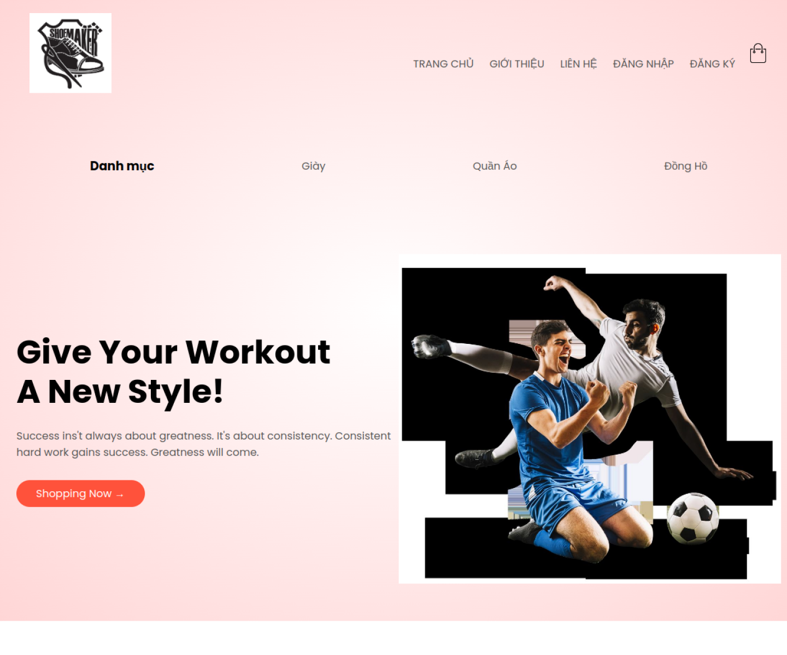
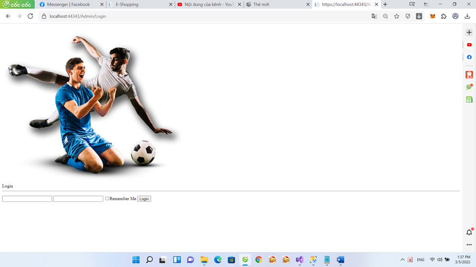
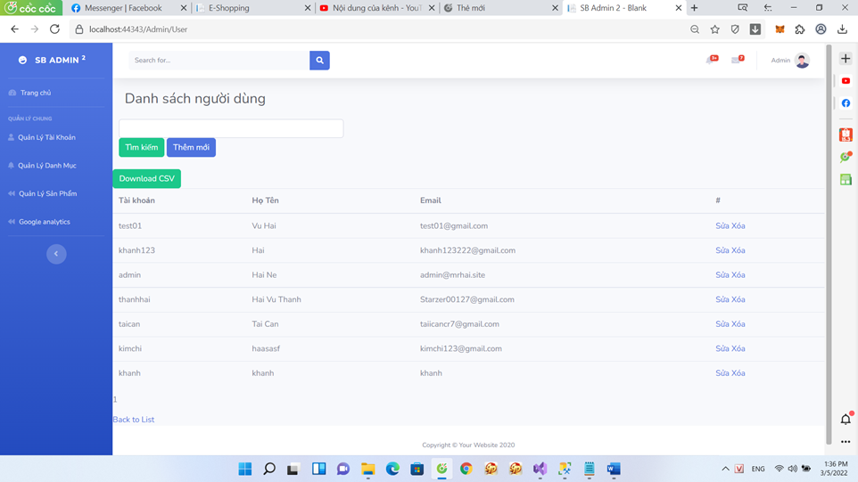
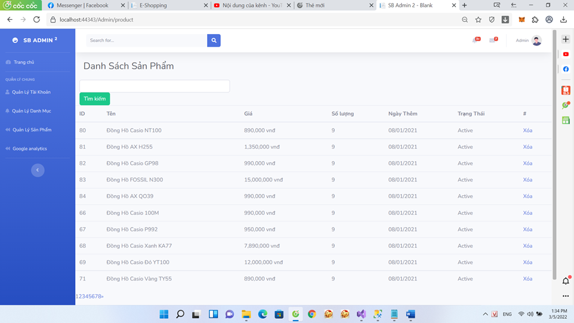
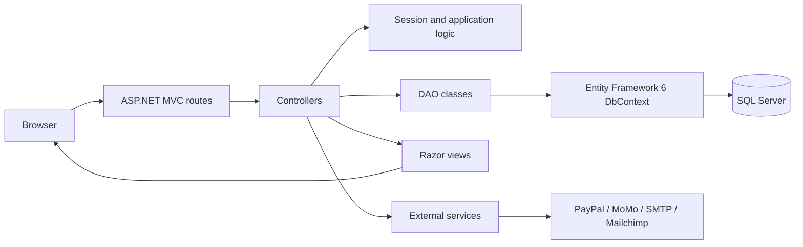

# E-Shop

An academic e-commerce website for men's sportswear and accessories, built with ASP.NET MVC 5, Entity Framework 6, and Microsoft SQL Server.

> This project was developed by a three-person university team in 2021–2022 through hands-on design, implementation, debugging, and testing. AI-assisted coding tools were not used during the original development.

## Live demo

- Website: [https://onlineshop.somee.com](https://onlineshop.somee.com)
- Video walkthrough: [YouTube demo](https://youtu.be/7Yevvb312nY)
- Admin area: [https://onlineshop.somee.com/Admin/Login](https://onlineshop.somee.com/Admin/Login)

The demo runs on a free shared-hosting plan. Its first request may be slower after a period of inactivity while the application and database connection start again.

## Features

### Customer-facing website

- Browse products by category with pagination.
- View product details, prices, descriptions, and related products.
- Register, sign in, and sign out.
- Add products to the cart, change quantities, remove individual items, or clear the cart.
- Enter shipping details and create an order.
- Submit a contact form.
- Legacy PayPal and MoMo payment integration code for demonstration and sandbox use.
- SEO-friendly product routes, `robots.txt`, sitemap generation, and Open Graph metadata.

### Administration area

- Separate administrator sign-in and session-protected pages.
- Search, create, edit, and delete user accounts.
- Create, edit, inspect, and delete product categories.
- Search, list, and delete products.
- Administrative dashboard and legacy Google Analytics integration.

## Screenshots

### Storefront



### Store administration

| Administrator sign-in | User management |
| --- | --- |
|  |  |



The screenshots were captured during the original university-project development, so localhost URLs and the earlier interface state may be visible.

## Technology stack

| Area | Technology |
| --- | --- |
| Language | C# |
| Web framework | ASP.NET MVC 5.2.7 on .NET Framework 4.7.2 |
| Data access | Entity Framework 6.4.4, DAO pattern |
| Database | Microsoft SQL Server |
| Views | Razor, HTML5, CSS3 |
| Front end | Bootstrap 3.4.1, jQuery 3.4.1, JavaScript |
| Hosting | IIS / Somee Windows hosting |
| Other integrations | PayPal SDK, MoMo sandbox code, SMTP email, Mailchimp |

## Architecture



The application follows the traditional ASP.NET MVC separation:

- **Presentation layer:** Razor views, static assets, client-side JavaScript, and the public/admin layouts in `NetCuoiKy`.
- **Application layer:** MVC controllers, routing, session-based authentication, cart handling, and checkout flows in `NetCuoiKy`.
- **Data-access layer:** DAO classes and Entity Framework entities in `Model`.
- **Shared services:** reusable helpers, including email support, in `Common`.
- **Database:** SQL Server stores users, products, categories, orders, contacts, and site content.

## Repository structure

```text
E-Shop/
├── Common/                 Shared helpers and services
├── Model/
│   ├── Dao/                Data-access objects
│   └── EF/                 Entity Framework entities and DbContext
├── NetCuoiKy/
│   ├── App_Start/          MVC routes and application configuration
│   ├── Areas/Admin/        Administration controllers and views
│   ├── Controllers/        Customer-facing controllers
│   ├── Models/             View models and session/cart models
│   ├── Views/              Razor views
│   └── Areas/Client/       Storefront CSS and images
├── docs/screenshots/       README screenshots
├── tools/                  Maintenance utilities
├── script3.sql             Local SQL Server setup script
├── script3.somee.sql       Somee-compatible database script
└── NetCuoiKy.sln           Visual Studio solution
```

## Run locally

### Prerequisites

- Windows 10 or later.
- Visual Studio 2019 or newer with the **ASP.NET and web development** workload.
- .NET Framework 4.7.2 Developer Pack/Targeting Pack.
- SQL Server and SQL Server Management Studio.

### 1. Clone the repository

```powershell
git clone https://github.com/kaizy1227/E-Shop.git
cd E-Shop
```

### 2. Create the local database

Open `script3.sql` in SQL Server Management Studio and execute it. The script creates and selects a database named `Acount`, then creates the required tables and sample data.

If `Acount` already exists, back it up and review the first `CREATE DATABASE` statement before running the script again.

### 3. Configure the connection string

Update the `OnlineShop` connection string in `NetCuoiKy/Web.config` for your SQL Server instance. For example, with Windows authentication:

```xml
<add name="OnlineShop"
     connectionString="data source=.;initial catalog=Acount;integrated security=True;MultipleActiveResultSets=True;App=EntityFramework"
     providerName="System.Data.SqlClient" />
```

Do not commit database passwords, SMTP passwords, API keys, or payment credentials. Use development/sandbox credentials only.

### 4. Restore and start the application

1. Open `NetCuoiKy.sln` in Visual Studio.
2. Restore the NuGet packages when prompted.
3. Set `NetCuoiKy` as the startup project.
4. Select IIS Express and run the solution with `F5`.
5. Open the HTTPS address shown by Visual Studio. The project is configured with local IIS Express SSL port `44343`.

## Demo accounts

| Role | Username | Password |
| --- | --- | --- |
| Administrator | `admin` | `admin` |
| Customer | `test01` | `123123` |

These credentials are intentionally retained for the public portfolio demo. Do not reuse them for a production deployment or store real customer data in this application.

## Deploy to Somee

1. Create an ASP.NET website using .NET Framework 4.7.2 and an MS SQL database in the Somee control panel.
2. Open the database's **Run scripts** page and execute `script3.somee.sql`. This version does not attempt to create or select a local database.
3. Publish the `NetCuoiKy` project in the `Release` configuration to a folder.
4. Set the deployed `OnlineShop` connection string to the value provided by Somee. Keep the password outside source control.
5. Upload the published files to the website root so that `Web.config`, `bin`, `Views`, and `Areas` are directly inside that root.
6. In **Domains / Bindings**, attach a free certificate to the domain and verify the HTTPS URL.

The current portfolio deployment is available at [https://onlineshop.somee.com](https://onlineshop.somee.com).

## Image optimization

The repository includes a reproducible Pillow-based utility that resizes and compresses storefront images:

```powershell
python tools/optimize_images.py
```

Review generated image changes before committing them. Keep an original backup when working with assets that are not already tracked in Git.

## Legacy and security notice

This repository represents a university project rather than a production-ready commerce platform. Before adapting it for real users, at minimum:

- Replace the demo authentication approach with a maintained identity system and properly hashed, salted passwords.
- Move all secrets and connection strings to protected environment-specific configuration.
- Rotate any historical third-party credentials that may have appeared in earlier commits.
- Add authorization checks, CSRF protection reviews, input validation, secure payment callbacks, logging, and automated tests.
- Upgrade legacy dependencies and perform a dedicated security review.

## Project background

- **Period:** 2021–2022
- **Context:** university e-commerce coursework
- **Team size:** three developers
- **Repository maintainer:** [kaizy1227](https://github.com/kaizy1227)

The project demonstrates foundational web-development skills: MVC organization, relational database design, server-rendered UI, authentication flows, CRUD administration, cart state, checkout logic, third-party integration, debugging, and IIS deployment.

## License

This repository does not currently include an open-source license. Contact the repository owner before redistributing or reusing the code outside educational review.
